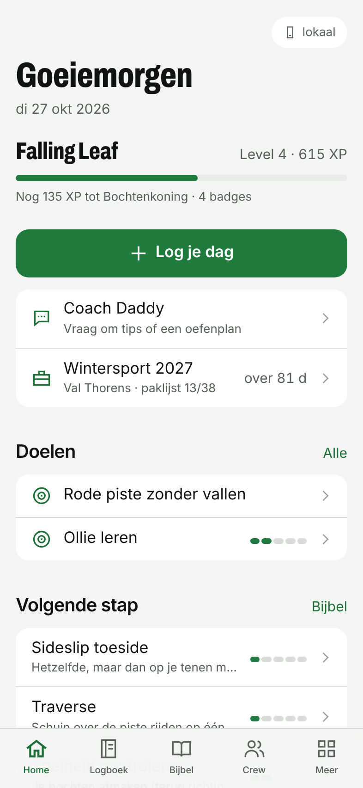
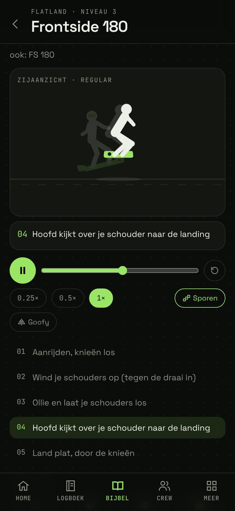
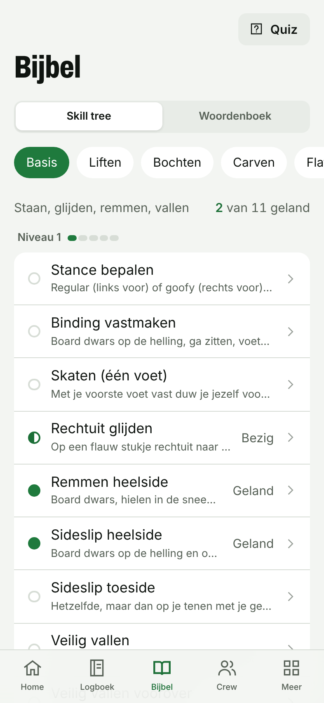
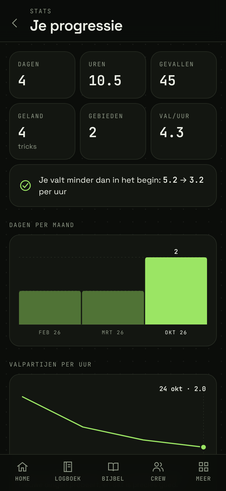

# Sneeuw Daddy

Je snowboard-logboek, trick-bijbel en crew in één app. Gebouwd als PWA: installeer hem op je iPhone via Safari en hij voelt als een echte app, ook offline op de berg.

<p>
  
  
  
  
</p>

## Wat zit erin

| Onderdeel            | Wat het doet                                                                                                                                                                                                                                            |
| -------------------- | ------------------------------------------------------------------------------------------------------------------------------------------------------------------------------------------------------------------------------------------------------- |
| **Logboek**          | Per dag: waar, uren, valpartijen, pistes, sneeuw & weer, mood, wat je oefende en landde, pijntjes, met wie, foto's/video's, notities. Per seizoen gegroepeerd.                                                                                          |
| **Trick-bijbel**     | 63 skills en tricks in 7 tracks (basis, liften, bochten, carven, flatland, park, freeride) met stappen, veelgemaakte fouten, veiligheid, tips en een YouTube-zoeklink.                                                                                  |
| **Animaties**        | Elke trick heeft een eigen animatie (pseudo-3D rider) met stappen die meelopen, slow-motion, scrubben, bewegingssporen en een goofy-spiegeling. Bochten in bovenaanzicht met heel/toe-edges.                                                            |
| **Skill tree**       | Voorkennis per trick als advies, nooit als slot. Je mag alles proberen.                                                                                                                                                                                 |
| **Woordenboek**      | 120 termen: board, gear, Berg 101 (FR vs AT), sneeuw, park, trick-namen, slang.                                                                                                                                                                         |
| **Kluis**            | Al je gelande tricks met je eigen clips erbij.                                                                                                                                                                                                          |
| **Levels & badges**  | XP uit je echte data. 11 levels van _Groentje_ tot _Sneeuw Daddy_, 27 badges.                                                                                                                                                                           |
| **Stats**            | Dagen per maand, valpartijen per uur, progressie per onderdeel, mood, pistes.                                                                                                                                                                           |
| **Doelen & trips**   | Doelen per trick of trip, aftellen, paklijst met standaard template.                                                                                                                                                                                    |
| **Sneeuwradar**      | 7-daagse voorspelling + sneeuwhoogte voor 27 gebieden in Frankrijk en Oostenrijk (Open-Meteo), offline gecachet.                                                                                                                                        |
| **Gear & stance**    | Je setup, bindinghoeken met tekening, boardlengte-check.                                                                                                                                                                                                |
| **Quiz**             | Termen, definities, "welke trick zie je" (met animatie) en voorkennis.                                                                                                                                                                                  |
| **Crew**             | Vriendengroep met invite-code: gedeelde feed van dagen, tricks en media, reacties en een XP-leaderboard.                                                                                                                                                |
| **Coach Daddy**      | AI-buddy (Claude) die je logboek, tricks en doelen kent. Tips, oefenplannen, uitleg.                                                                                                                                                                    |
| **Skipas (profiel)** | Je eigen pagina als skipas: foto, stance, thuisresort, level. Stickerboek met je gelande tricks, eerlijke stats (valpartijen als trofee), signature trick, badges en highlights. Je crew stelt bijnamen voor, jij kiest. Alleen zichtbaar voor je crew. |
| **Meldingen**        | Push op je iPhone (vanaf het beginscherm): crew deelt een dag, crew-doel gehaald, en om 17:00 tijdens een trip "Log je dag". Per soort aan/uit.                                                                                                         |
| **Story delen**      | Maak van een dag een 1080×1920 story-kaart in de huisstijl en deel hem via het iOS-deelmenu.                                                                                                                                                            |

Plus: offline-first met sync, donker/licht thema, zachte geluidjes en confetti, eigen icon-set (nooit emoji), safe areas voor de Dynamic Island.

## Snel starten

```bash
npm install
npm run dev          # http://localhost:5173
npm test             # vitest
npm run lint         # prettier-check + typecheck
npm run build        # productie-build in dist/
```

Zonder verdere configuratie draait de app **volledig lokaal**: alles staat in IndexedDB op je toestel. Account, sync, crews en de coach worden actief zodra je Supabase koppelt.

## Backend koppelen (Supabase, ~10 minuten)

1. Maak een gratis project op [supabase.com](https://supabase.com).
2. **Database**: open de SQL editor en voer `supabase/migrations/20261026000000_init.sql` uit (of `supabase db push` met de CLI). Dit maakt de tabellen, Row Level Security, de crew-functies en de `media` storage-bucket aan.
3. **Auth**: zet onder _Authentication → Providers_ e-mail aan. Wil je zonder mailbevestiging kunnen inloggen, zet dan _Confirm email_ uit.
4. **Env**: kopieer `.env.example` naar `.env.local` en vul `VITE_SUPABASE_URL` en `VITE_SUPABASE_ANON_KEY` in (_Project Settings → API_).
5. Start opnieuw met `npm run dev`. In _Meer → Instellingen_ kun je nu een account maken. Wat je al lokaal had gelogd, gaat automatisch mee.

### Coach Daddy aanzetten

De coach draait als Supabase Edge Function, zodat je Anthropic API-key **nooit** in de app terechtkomt.

```bash
npm i -g supabase
supabase login
supabase link --project-ref <jouw-project-ref>
supabase secrets set ANTHROPIC_API_KEY=sk-ant-...
supabase secrets set COACH_DAILY_LIMIT=60      # optioneel, berichten per persoon per dag
supabase functions deploy coach
```

**Automatisch deployen via GitHub:** de workflow `.github/workflows/deploy-functions.yml` zet de coach live zodra er op `main` iets in `supabase/functions/` verandert, of handmatig via Actions > Deploy Edge Functions > Run workflow. Eenmalig nodig: maak in Supabase (Account > Access Tokens) een token en zet het in GitHub als repository secret `SUPABASE_ACCESS_TOKEN` (Settings > Secrets and variables > Actions). De Anthropic-key blijft een Supabase secret.

Over de kosten: de coach gebruikt Claude Opus 5.5 met `effort: low` (snel en zuinig voor chat) en prompt caching. Een gemiddeld bericht met je logboek als context kost grofweg 1 à 2 cent, dus €100 aan credits is ruim duizenden berichten. Het daglimiet per gebruiker beschermt je budget als je crew de coach ook gebruikt. Verbruik per persoon per dag staat in de tabel `coach_usage`.

### Push-meldingen aanzetten

1. Draai `supabase/migrations/20261028000000_push.sql` in de SQL Editor.
2. Run de workflow Actions > Deploy Edge Functions. Die maakt de eerste keer zelf de VAPID-keys aan (als Supabase secret, nooit in de log) en zet de function `push` live.
3. Draai `supabase/cron/push_reminder.sql` in de SQL Editor voor de "Log je dag"-herinnering (pg_cron, elk uur).
4. Op je iPhone: app op het beginscherm, dan Instellingen > Meldingen. Met "Stuur een testmelding" check je of het werkt.

## Deployen

**Vercel / Netlify**: importeer de repo, build command `npm run build`, output `dist`, en zet de twee `VITE_SUPABASE_*` variabelen. Gebruik je de Vercel-Supabase-integratie, dan hoeft dat niet: de build pakt ook `NEXT_PUBLIC_SUPABASE_URL` / `SUPABASE_ANON_KEY` (en de publishable-varianten) op. De service-role key wordt nooit in de app gebakken.

**GitHub Pages**: de workflow `.github/workflows/pages.yml` bouwt en publiceert bij elke push naar `main`. Zet in de repo-instellingen _Pages → Source_ op _GitHub Actions_ en voeg (optioneel) de secrets `VITE_SUPABASE_URL` en `VITE_SUPABASE_ANON_KEY` toe.

### Op je iPhone zetten

1. Open de URL in **Safari**.
2. Tik op **Deel** → **Zet op beginscherm**.
3. Open hem vanaf je beginscherm: volledig scherm, offline, en iOS bewaart je data dan veel langer dan in een gewoon browsertabblad.

## Projectstructuur

```
src/
  anim/         animatie-engine (keyframes, pseudo-3D pose, player)
  components/   gedeelde UI (ui.tsx, Charts, Media, Pickers, ...)
  content/      trick-bijbel, woordenboek, skigebieden, paklijst, animatie-builders
  design/       icon-set en medailles van het design system
  lib/          data (Dexie), sync, auth, crew, coach, xp/badges, weer, share-kaart
  pages/        alle schermen
  test/         vitest (content-integriteit, xp, opslag, design-regels)
supabase/
  migrations/   database-schema + RLS
  functions/    coach (Edge Function)
docs/           DESIGN.md, ARCHITECTURE.md, screenshots
```

Meer weten: [`docs/DESIGN.md`](docs/DESIGN.md) (design system) en [`docs/ARCHITECTURE.md`](docs/ARCHITECTURE.md) (data, sync, crew, coach). De roadmap staat in de GitHub issues.
